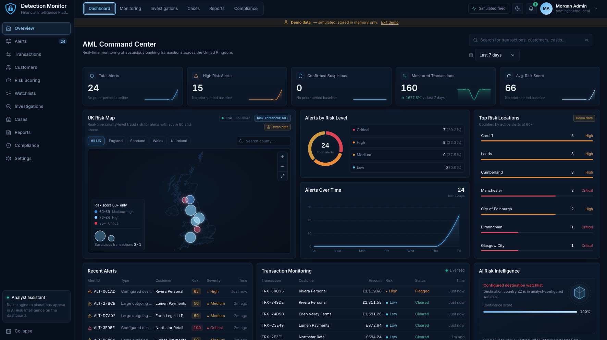
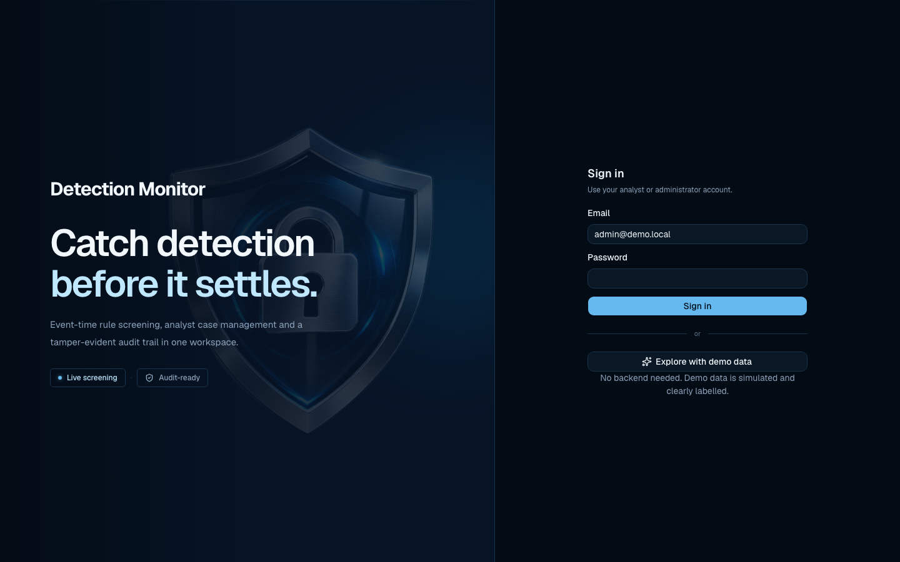

# Design System

The Detection Monitor interface is a dark-first, data-dense analyst workspace. This document records the design tokens and conventions used in `frontend/` (React) and mirrored in `frontend-vue/`. Where the implementation differs from the stated target, that is called out in [Implementation status](#implementation-status).

## Contents

- [Visual references](#visual-references)
- [Branding](#branding)
- [Colour](#colour)
- [Typography](#typography)
- [Design principles](#design-principles)
- [Layout and spacing](#layout-and-spacing)
- [Components and shadcn/ui conventions](#components-and-shadcnui-conventions)
- [Iconography](#iconography)
- [Motion](#motion)
- [Charts and maps](#charts-and-maps)
- [Severity visualisation](#severity-visualisation)
- [Accessibility](#accessibility)
- [Implementation status](#implementation-status)

## Visual references

*AML Command Center (simulated demo data): sidebar, top navigation, KPI row, map, donut, area chart, ranked locations and tables.*

*Sign-in: split layout with brand hero (shield artwork, headline, status chips) and a compact form.*

## Branding

| Item | Value |
|---|---|
| Application name | **Detection Monitor** (bold weight in the wordmark) |
| Tagline | Catch detection before it settles. |
| Strapline | Financial intelligence, detection and real-time transaction monitoring for UK banking workflows. |
| Logo | Shield-and-padlock mark plus wordmark, implemented in `DetectionMonitorLogo.tsx` / `.vue`. Hero artwork: `public/images/detection-shield.png` |

Ownership and licensing of the logo artwork is **unconfirmed**; see [COPYRIGHT.md](COPYRIGHT.md).

## Colour

Dark mode is the default; the `<html>` element carries `.dark`. Tokens are CSS custom properties in `frontend/src/index.css`, exposed to Tailwind 4 through `@theme inline`.

| Role | Hex | Token |
|---|---|---|
| Midnight background (outermost) | `#030B14` | `--app` |
| Dashboard background | `#071426` | `--background` |
| Sidebar | `#051225` | `--sidebar` |
| Cards | `#0B1E33` | `--card` |
| Borders | `#1B344D` | `--border`, `--input` |
| Accent blue | `#65B9EE` | `--primary`, `--ring` |
| Ice blue | `#BFE8FF` | `--ice` |
| Primary text | `#F2F7FC` | `--foreground` |
| Secondary text | `#8CA2BA` | `--muted-foreground` |

Supporting tokens: popover/secondary/muted/accent surface `#10263D`, highlight `#8DD4FA` (`--hl`), subtle text `#607891`, success `#28B99D`, destructive `#E85D68`. Chart series: `#65B9EE`, `#8DD4FA`, `#BFE8FF`, `#4F9BD9`, `#1E5A91`.

A light theme exists (`:root:not(.dark)`); dark remains the default and the reference design. Theme selection is handled by `components/theme-provider.tsx`.

## Typography

| Use | Typeface | Notes |
|---|---|---|
| Interface text, headings | **Geist Sans** (`@fontsource-variable/geist`) | Falls back to `ui-sans-serif, system-ui` |
| Identifiers, hashes, amounts, code | **Geist Mono** (`@fontsource-variable/geist-mono`) | Tabular figures for alignment |
| Branding | Geist Sans, bold | Application name set bold |

Conventions: compact professional financial presentation: small caption sizes (10–12 px) for metadata, ~13–14 px body, large numerals for KPIs, right-aligned monetary columns, GBP with `£` and two decimals.

## Design principles

1. **Data first.** Numbers, status and evidence lead; decoration supports them. Every KPI states its comparison basis (for example "No prior-period baseline").
2. **Dark mode default.** Deep navy surfaces, low-chroma borders, a single blue accent.
3. **Strict 5px border radius** for dashboard controls and cards (target; see [status](#implementation-status)).
4. **Responsive layouts.** Collapsible sidebar, mobile navigation drawer, grid cards that reflow.
5. **Premium, restrained motion.** Short, purposeful, and disabled under `prefers-reduced-motion`.
6. **Accessible interactions.** Keyboard reachable, visible focus, text labels paired with colour.
7. **Clear severity visualisation.** Same colours and labels everywhere a score appears.
8. **Honest data labelling.** Simulated data is always labelled as such ("Demo data" banner and badges).

## Layout and spacing

- Shell: fixed left sidebar (~216 px expanded), top bar with primary tabs, global search, date range, notifications and account menu, then a scrolling content area.
- Dashboard grid: five KPI cards on one row, then map (wide) beside two stacked chart cards and a ranked list, then three data panels.
- Spacing follows Tailwind's 4 px scale: 12–16 px card padding, 8–12 px gaps inside cards, 16 px between cards.
- Cards use `--card` with a 1 px `--border`; hover brightens the border towards the accent.

## Components and shadcn/ui conventions

- `frontend/components.json` configures shadcn/ui (`radix-nova` style, CSS variables, Tailwind 4, `@/components/ui` alias). `components/ui/` includes button, card, dialog, sheet, select, badge, skeleton, sonner, chart and sidebar primitives, among others.
- Add components with the shadcn CLI, then adapt through **tokens**, not per-component hard-coded colours.
- Merge classes with `cn()` (`@/lib/utils`); variants use `class-variance-authority`.
- Application-specific compositions live in `components/app/` (KPI card, risk map, alert sheet, audit timeline, case view); do not edit generated primitives for one-off needs.
- Skeletons for loading, explicit empty and error states, toasts via Sonner, and an error boundary around pages.

## Iconography

- Dashboard icons use **Hugeicons** through the `Icon` wrapper (`components/app/icon.tsx`): light-blue stroke, stroke width 1.6, colour via `currentColor`, `aria-hidden` by default.
- **Lucide** icons appear in shadcn primitives and a few views.
- Icons never carry meaning alone: pair them with a text label or an accessible name.

## Motion

- **Motion for React** (`motion`) drives entrances and number count-up on KPI cards; D3 transitions drive map markers and zoom.
- Durations: 150–300 ms for UI feedback, up to ~1.6 s for the live-event pulse on the map. Easing is cubic out/in-out.
- `prefers-reduced-motion: reduce` is honoured in global CSS and the map's duration helper.
- Animation must never delay access to data or the primary action.

## Charts and maps

| Chart | Library | Notes |
|---|---|---|
| Alerts by Risk Level (donut + legend) | Recharts / ECharts (Vue) | Centre label shows total; legend lists count and percentage |
| Alerts Over Time (area) | Recharts / ECharts (Vue) | Accent blue line, soft gradient fill, minimal gridlines |
| KPI sparklines | SVG | No axes; trend only |
| Watchlist hits (step chart) | Recharts | Stacked categories, `#030B14` plot well |
| Dashboard UK Risk Map | D3 + topojson | County shading, proportional markers, zoom controls, county search, nation filters |
| UK Risk Map page | MapLibre GL | Dark basemap from OpenFreeMap; attribution always shown |

Style rules: no chart junk, thin 1 px gridlines in `--border`, axis text in `--muted-foreground` at 10–11 px, direct value labels where possible, tooltips on `--popover`, and a text alternative (`aria-label`, ranked list) for every map.

## Severity visualisation

| Level | Colour | Glyph | Used for |
|---|---|---|---|
| Low | `#64C9DE` | ● | Scores below 40 |
| Medium | `#D9AA56` | ▲ | 40–59 |
| High | `#F1A052` | ◆ | 60–79 |
| Critical | `#E85D68` | ⬢ | 80 and above |

Dashboard bands come from `frontend/src/lib/risk.ts`. Alert-queue and map bands are different and are documented in [RULE.md](RULE.md#score-bands-in-different-views): 60–69 Elevated, 70–84 High, 85–100 Critical. Always show the text label together with the colour and glyph.

## Accessibility

- Colour is never the only signal: severity uses label + glyph + colour.
- Maps expose `role="img"` with a descriptive label and provide keyboard alternatives (county search, ranked list).
- Interactive controls use native elements or Radix/Base UI primitives for focus management and ARIA.
- Contrast: primary and secondary text on the card and dashboard surfaces are intended to meet WCAG 2.2 AA for normal text; this has **not** been formally audited.
- The Accessibility page in the app is a statement of intent, not a conformance claim.

## Implementation status

| Item | Target | Actual |
|---|---|---|
| 5 px radius | All dashboard controls and cards | Enforced by scoped CSS on the Alerts, City Inequality, Investigations and Watchlist chart areas. The global shadcn `--radius` is `0.625rem` and `.dash-card` is 10 px; the Vue variant uses Tailwind `rounded-lg`/`rounded-md`. Unifying these is outstanding work |
| Dark default | Yes | Yes |
| Geist fonts | Yes | Yes (self-hosted via Fontsource) |
| Contrast audit | WCAG 2.2 AA | Not performed |
| Component library in Vue variant | shadcn/ui | Not applicable: Vue uses Reka UI and custom components |
