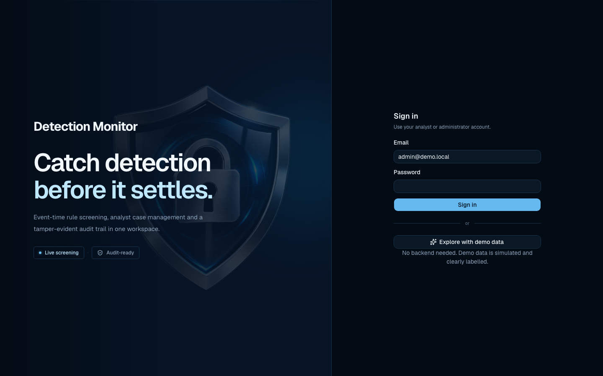
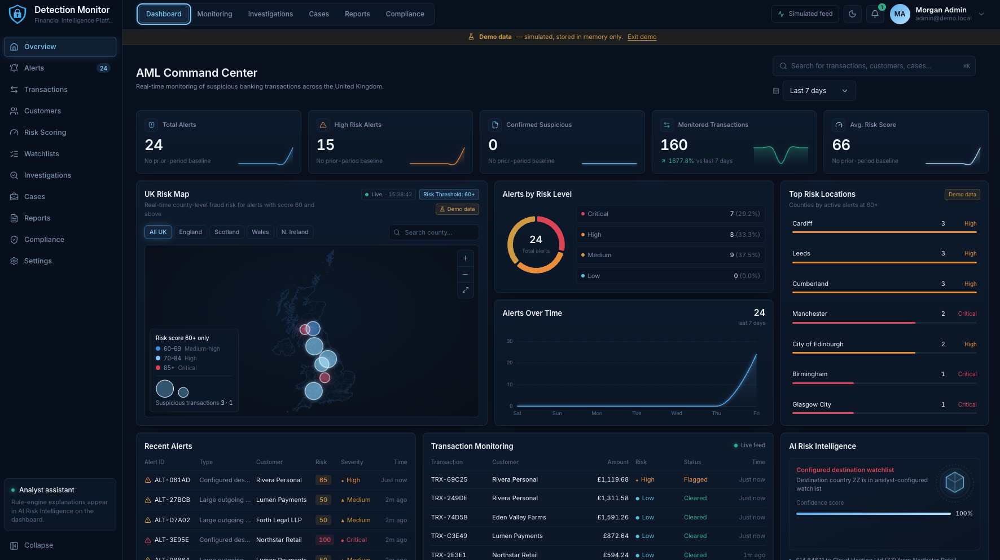

<div align="center">


# **Detection Monitor**

## Catch detection<br>before it settles.

Event-time rule screening, analyst case management and a tamper-evident audit trail in one workspace.

</div>

<br />

[](RISK.md)
[](backend/Dockerfile)
[](backend/requirements.txt)
[](frontend/package.json)
[](frontend/package.json)
[](frontend/vite.config.ts)
[](compose.yaml)
[](compose.yaml)
[](compose.yaml)
[](LICENSE.md)

Detection Monitor is a UK-focused transaction monitoring, AML analytics and investigation platform. It ingests payment events, screens them against configurable rules, raises risk-scored alerts, supports analyst case review, maps alert concentration across UK counties, and records every material action in a hash-linked audit trail.

> **Read this first.** Detection Monitor is a portfolio-grade **MVP**. All bundled data is synthetic. It is **not** production-certified, **not** approved or authorised by the FCA, and **not** affiliated with any UK government body. See [Demo Mode](#demo-mode) and [RISK.md](RISK.md).

### Authentication Interface



*The sign-in page, with the option to explore with simulated demo data and no backend.*

### Dashboard Preview



*The AML Command Center in demo mode: KPI cards, UK Risk Map (alerts scoring 60 and above), alerts by risk level, alerts over time, top risk locations, recent alerts, transaction monitoring and the rule-based risk panel. Every figure in this screenshot is **simulated** (the banner reads "Demo data — simulated, stored in memory only").*

## Table of contents

- [Overview](#overview)
- [Features](#features)
- [Application Screenshots](#application-screenshots)
- [Technology Stack](#technology-stack)
- [System Architecture](#system-architecture)
- [Getting Started](#getting-started)
- [Environment Configuration](#environment-configuration)
- [Running with Docker](#running-with-docker)
- [API Documentation](#api-documentation)
- [Detection Rules](#detection-rules)
- [Transaction Monitoring](#transaction-monitoring)
- [UK Risk Map](#uk-risk-map)
- [Alerts and Investigations](#alerts-and-investigations)
- [Audit History](#audit-history)
- [Demo Mode](#demo-mode)
- [Testing](#testing)
- [Security](#security)
- [Documentation Index](#documentation-index)
- [Licence and Copyright](#licence-and-copyright)

## Overview

| Area | What Detection Monitor does |
|---|---|
| Ingestion | Authenticated, idempotent `POST /api/transactions`. Decimal money, external-ID de-duplication, payload-conflict detection. |
| Screening | An asynchronous worker evaluates enabled rules against each transaction, sums rule weights (capped at 100) and raises an alert at or above a threshold. |
| Investigation | Analysts claim, review, escalate and close alerts. Closure requires a disposition and a written note. |
| Geography | The UK Risk Map plots only alerts with `risk_score >= 60`, located by the account's recorded UK local authority. |
| Assurance | An append-only, SHA-256-linked audit log records user and system actions and can be verified by an administrator. |

The repository contains three front-end/data components:

| Path | Purpose |
|---|---|
| `backend/` | FastAPI service, rule engine, worker, audit chain, tests |
| `frontend/` | Primary React + TypeScript analyst UI (served by Docker Compose) |
| `frontend-vue/` | Vue 3 port of the UI, with an AML Command Center layout. **Not** part of Docker Compose. The dashboard screenshot above was captured from this variant |
| `uk-population-map/`, `uk-cities-inequality/` | Supporting data-visualisation experiments and their ONS source data |

## Features

Status key: **Implemented** = present in the code in this repository. **Demo-only** = works against simulated in-browser data. **Planned** = not implemented.

| Capability | Status | Notes |
|---|---|---|
| Real-time transaction monitoring | Implemented | Outbox-driven worker with Redis wake-ups; UI auto-refreshes; live-feed streams exist for the investigations register and watchlist hits. "Real-time" means near-real-time on synthetic or sandbox data, not a connection to live payment rails |
| Configurable fraud risk rules | Implemented | Four rule kinds, validated config, weights, enable/disable, optimistic version checks |
| Risk scoring and suspicious alerts | Implemented | Score = sum of matched rule weights, capped at 100 |
| Analyst investigation workflows | Implemented | Investigation workspace with IP/geo context, risk factors, linked alerts, evidence attestation and timeline |
| Case management | Implemented | `OPEN → IN_REVIEW → ESCALATED → CLOSED` with server-side transition rules |
| Watchlist monitoring | Implemented (configured country codes) | Matches a **configurable list of country codes**. It is **not** a maintained sanctions, PEP or adverse-media dataset |
| UK geographic risk analysis | Implemented | County-level map and Top Risk Locations; accounts need a UK local-authority (GSS) code |
| Animated dashboard KPIs | Implemented | Count-up KPI cards and sparklines |
| Interactive charts | Implemented | Donut, time-series, step chart, map |
| CSV investigation exports | Implemented | Filtered/page/selected/all scopes, formula-injection neutralisation, audited, large exports run as background jobs |
| Tamper-evident audit history | Implemented | SHA-256 hash chain with admin verification endpoint (see limits in [SECURITY.md](SECURITY.md)) |
| Role-based access controls | Implemented | Two roles, `admin` and `analyst`, enforced server-side |
| TrueLayer open-banking import | Sandbox only | Admin-triggered import from the TrueLayer **sandbox**. No production banking connection |
| Merchant logos (Logo.dev) | Optional | Shown only for analyst-verified counterparty → domain bindings |
| "Analyst assistant" / AI Risk Intelligence panel | Implemented as deterministic text | Restates stored rule evidence. It is **not** a language model and does not produce independent risk assessments |
| SSO / MFA, rate limiting, JWT rotation | Planned | See the hardening backlog in [RISK.md](RISK.md) |
| Sanctions/PEP data feeds, SAR/STR workflow | Planned | Not implemented |
| Customers, Reports, Settings pages (Vue variant) | Placeholder | Render a placeholder screen in `frontend-vue/` |

## Application Screenshots

| Screenshot | File |
|---|---|
| AML Command Center dashboard (simulated demo data) | [`docs/images/dashboard-overview.png`](docs/images/dashboard-overview.png) |
| Detection Monitor sign-in page | [`docs/images/login-screen.png`](docs/images/login-screen.png) |

Both images are real captures of the running application and are reproduced unmodified. The dashboard figures (24 alerts, 160 monitored transactions, average risk score 66, and so on) come from the in-memory demo feed and carry no real-world meaning. See [COPYRIGHT.md](COPYRIGHT.md) for screenshot provenance.

## Technology Stack

**Frontend (`frontend/`)**

| Technology | Use |
|---|---|
| React 19, TypeScript 5.7, Vite 6 | Application shell and build |
| Tailwind CSS 4, shadcn/ui (Radix UI and Base UI primitives) | Styling and components |
| Motion for React (`motion`) | Animation |
| Recharts | Charts |
| D3.js and topojson-client | Dashboard county risk map |
| MapLibre GL via `react-map-gl` | Dedicated UK Risk Map page (OpenFreeMap vector tiles) |
| TanStack Query, Sonner, next-themes | Data fetching, toasts, theming |
| Geist Sans / Geist Mono, Hugeicons, Lucide | Typography and icons |
| Vitest | Front-end unit tests |

`frontend-vue/` uses Vue 3, Reka UI, ECharts, `motion-v`, D3 and Tailwind CSS 4.

**Backend (`backend/`)**

| Technology | Use |
|---|---|
| Python 3.12, FastAPI, Uvicorn | REST API and OpenAPI docs |
| SQLAlchemy 2, PostgreSQL 16 (`psycopg`) | Persistence. Tests use SQLite |
| Redis 7 | Best-effort worker wake-up and brand-search cache. The PostgreSQL outbox is the durable queue |
| Asynchronous worker (`python -m app.worker`) | Outbox consumer with `SELECT … FOR UPDATE SKIP LOCKED` |
| PyJWT, argon2-cffi | Tokens and password hashing |
| httpx | Outbound calls to optional integrations |

**Optional integrations**

| Integration | State |
|---|---|
| TrueLayer (sandbox) | Operational in code, **sandbox endpoints only**; requires your own client secret |
| Logo.dev | Operational in code when keys are supplied |
| OpenFreeMap / OpenStreetMap tiles | Used by the MapLibre risk-map page; no key required |
| ONS boundary and population data | Bundled static files (Open Government Licence v3.0) |

There is **no** live IP-geolocation provider integration. Geolocation fields are captured with the transaction (the demo data uses a placeholder provider named `synthetic-demo`).

## System Architecture

```text
                       +---------------------------+
                       |     React analyst UI      |
                       |  Login / Alerts / Rules   |
                       +-------------+-------------+
                                     |
                               HTTPS / REST
                                     |
                       +-------------v-------------+
                       |        FastAPI API        |
                       |  Auth + validation + RBAC |
                       +-------------+-------------+
                                     |
                        single database transaction
                                     |
                       +-------------v-------------+
                       |         PostgreSQL        |
                       | transactions + outbox     |
                       | rules, alerts, audit      |
                       +-------------+-------------+
                                     ^
                            row locks / commits
                                     |
                       +-------------+-------------+
                       |   Screening worker        |
                       | event-time rule evaluation|
                       | scoring + audit writes    |
                       +-------------+-------------+
                                     ^
                          Redis list wake-up signal
                                     ^
                                FastAPI API
```

The API commits a `Transaction`, its `OutboxEvent` and an ingestion audit event in **one database transaction**. A Redis `LPUSH` nudges the worker, but a lost notification is harmless because the worker also polls the PostgreSQL outbox. The worker locks one event, evaluates enabled rules, writes matched-rule snapshots and any alert, appends audit events and marks the event processed, all in one commit. Re-processing an already screened transaction creates no duplicate alert.

Delivery is **at-least-once with idempotent screening effects**, not exactly-once. Events are retried up to five times, then marked terminal and the transaction is marked `FAILED` and audited.

More detail: [DESIGN.md](DESIGN.md) (UI) and [RULE.md](RULE.md) (detection logic).

## Getting Started

Prerequisites: **Docker Engine** with **Docker Compose v2** for the full stack, or Python 3.12+ and Node.js 22 for local development.

```bash
git clone <your-repository-url> detection-monitor
cd detection-monitor
cp .env.example .env
# Replace every example secret in .env before any exposed deployment.
docker compose up --build
```

Then open:

| Service | URL |
|---|---|
| Analyst UI (Nginx + compiled React app) | http://localhost:8080 |
| Interactive API docs (OpenAPI) | http://localhost:8000/docs |
| Health check | http://localhost:8000/api/health |

Demo accounts are seeded on first start: `admin@demo.local` (administrator) and `analyst@demo.local` (analyst). Their development-only passwords are the `DEMO_ADMIN_PASSWORD` and `DEMO_ANALYST_PASSWORD` values in `.env.example`. **Never** reuse them with real data or on a public deployment. Passwords are hashed at first seed, so changing `.env` later does not alter an existing database.

### Local front-end development

```bash
# terminal 1: docker compose up --build   (API, worker, PostgreSQL, Redis)
# terminal 2:
cd frontend
npm install
npm run dev        # http://localhost:5173, /api proxied to http://localhost:8000
```

The Vue variant is run the same way from `frontend-vue/` (`npm install && npm run dev`).

## Environment Configuration

Copy `.env.example` to `.env`. `.env` is git-ignored. Never commit secrets.

| Variable | Purpose | Notes |
|---|---|---|
| `POSTGRES_USER`, `POSTGRES_PASSWORD`, `POSTGRES_DB` | Database credentials | Replace the example password |
| `JWT_SECRET` | Signs access tokens (HS256) | Use at least 32 random bytes |
| `DEMO_ADMIN_PASSWORD`, `DEMO_ANALYST_PASSWORD` | Passwords for seeded demo users | Development only |
| `ALERT_THRESHOLD` | Minimum score that raises an alert | Default `40` |
| `JWT_TTL_MINUTES` | Token lifetime | Default `480` |
| `CORS_ORIGIN` | Allowed browser origin | Default `http://localhost:5173` |
| `EXPORT_ROLES`, `EXPORT_ASYNC_THRESHOLD`, `EXPORT_TTL_SECONDS`, `EXPORT_DIR` | CSV export controls | Defaults: `admin,analyst`, 5000 rows, 900 s |
| `TRUELAYER_CLIENT_ID`, `TRUELAYER_CLIENT_SECRET`, `TRUELAYER_REDIRECT_URI`, `TRUELAYER_API_URL`, `TRUELAYER_AUTH_URL` | TrueLayer **sandbox** | Keep the secret in your local `.env` only |
| `LOGO_DEV_SECRET_KEY` | Server-side brand search | Never prefix with `VITE_` |
| `VITE_LOGO_DEV_PUBLISHABLE_KEY` | Public logo image key | Baked into the front-end bundle by design |

Merchant logos: the free Logo.dev plan requires a visible "Logos provided by Logo.dev" attribution link in production. Logos are visual identifiers only, not evidence that a merchant is legitimate.

## Running with Docker

`compose.yaml` defines five services:

| Service | Image / build | Port |
|---|---|---|
| `postgres` | `postgres:16-alpine`, named volume `pgdata` | internal |
| `redis` | `redis:7-alpine`, persistence disabled | internal |
| `api` | `./backend` (seeds demo data when `SEED_DEMO=1`) | 8000 |
| `worker` | `./backend`, `python -m app.worker` | none |
| `web` | `./frontend` built, served by Nginx (proxies `/api`) | 8080 |

```bash
docker compose up --build     # start everything
docker compose logs -f worker # watch screening
docker compose down           # stop (keeps the database volume)
docker compose down -v        # stop and delete the database volume
```

The internal Compose project name is still `sentinel-monitor` and the API title reads "Sentinel", legacy names from before the rebrand.

## API Documentation

The full, interactive reference is served at `/docs` (OpenAPI). All `/api` routes except login and health require `Authorization: Bearer <token>`.

```bash
curl -s http://localhost:8000/api/auth/login \
  -H 'Content-Type: application/json' \
  -d '{"email":"admin@demo.local","password":"<DEMO_ADMIN_PASSWORD from your .env>"}'

TOKEN='<access_token from the response>'
curl -X POST http://localhost:8000/api/transactions \
  -H "Authorization: Bearer $TOKEN" -H 'Content-Type: application/json' \
  -d '{"external_id":"DEMO-PAYMENT-1001","account_id":"acct-retail-01","amount":"12500.00",
       "currency":"GBP","direction":"DEBIT","counterparty":"Example Vendor","country":"GB",
       "occurred_at":"2026-11-13T09:45:00Z"}'
```

Repeating an identical `external_id` and payload returns the existing record (HTTP 200); reusing the ID with different data returns HTTP 409.

| Endpoint | Access | Purpose |
|---|---|---|
| `POST /api/auth/login`, `POST /api/auth/logout` | Public / authenticated | Issue and revoke a token |
| `GET /api/me` | Authenticated | Current user and role |
| `GET /api/overview`, `GET /api/analytics/daily` | Authenticated | KPIs and daily series |
| `POST /api/transactions`, `GET /api/transactions[/{id}]` | Authenticated | Ingestion and stream |
| `GET /api/risk-map` | Authenticated | Alerts with `risk_score >= 60`, by local authority |
| `GET /api/alerts[/{id}]`, `PATCH /api/alerts/{id}` | Authenticated | Queue, detail, review |
| `GET /api/alerts/{id}/investigation` | Authenticated | Investigation workspace (PII masked unless admin) |
| `POST /api/alerts/{id}/evidence-reviewed` | Authenticated | Audited evidence attestation |
| `GET /api/investigations`, `/summary`, `/stream`, `/export.csv`, `/exports/{job}` | Authenticated (export per `EXPORT_ROLES`) | Register and audited CSV export |
| `GET /api/watchlist/hits`, `/stream` | Authenticated | Watchlist hit analytics |
| `GET /api/rules`, `/rules/stats` | Authenticated | Rules and match statistics |
| `POST /api/rules`, `PATCH /api/rules/{id}` | **Admin** | Create and version-checked update |
| `GET /api/audit` | Authenticated | Audit events |
| `GET /api/audit/verify` | **Admin** | Verify hash-chain integrity |
| `GET /api/merchants`, `POST /api/merchants`, `GET /api/brands/search` | Authenticated | Verified merchant bindings and Logo.dev search |
| `GET /api/truelayer/connect`, `POST /api/truelayer/import` | **Admin** | TrueLayer sandbox import |

## Detection Rules

Four rule kinds are implemented. Seeded demo policies:

| Code | Kind | Trigger | Weight |
|---|---|---|---:|
| `LARGE_AMOUNT` | `AMOUNT_THRESHOLD` | Single payment ≥ 10,000 (transaction currency) | 50 |
| `WATCHLIST_COUNTRY` | `COUNTRY_WATCHLIST` | Country code in the configured list (seed uses synthetic `ZZ`) | 65 |
| `HIGH_VELOCITY` | `VELOCITY` | ≥ 3 outgoing payments in 10 minutes, same account and currency | 45 |
| `OUTFLOW_SPIKE` | `CUMULATIVE_AMOUNT` | Outgoing total ≥ 15,000 in 60 minutes, same account and currency | 35 |

Scores add up and are capped at 100. The default alert threshold is **40**. Thresholds are per currency and are **not** FX-normalised. Full explanation: [RULE.md](RULE.md).

## Transaction Monitoring

The monitoring view lists the transaction stream with score, status and screening state. Each transaction keeps an immutable snapshot of the rules that matched (code, version, configuration, points and reason), so later rule edits never rewrite history. Late-arriving transfers do not automatically re-score earlier transactions.

## UK Risk Map

`GET /api/risk-map` returns open alerts with `risk_score >= 60` (the configured `RISK_MAP_THRESHOLD`), located by the **account's recorded UK local authority** (GSS code). It never uses an IP guess or a street address. Alerts on accounts without a local-authority code are counted as `unlocated` and not plotted. Bands: **60–69 Elevated/Medium-high, 70–84 High, 85–100 Critical**.

## Alerts and Investigations

1. A rule match contributes to a transaction's score.
2. A score at or above the threshold creates an **alert** (priority `LOW` < 50, `MEDIUM` 50–74, `HIGH` ≥ 75).
3. An analyst claims the alert, moves it to `IN_REVIEW` or `ESCALATED`, records evidence and notes.
4. Closing requires a disposition (`SUSPICIOUS` or `FALSE_POSITIVE`) and a note of at least 10 characters. Closed cases are immutable. A confirmed GBP loss can be recorded only when closing as `SUSPICIOUS`.
5. The investigations register supports filtering and audited CSV export. Personal data (IP addresses, customer addresses) is masked server-side for non-admins.

## Audit History

Every ingestion, screening result, alert, review, rule change, export, merchant verification and personal-data view is appended to a SHA-256-linked log. `GET /api/audit/verify` (admin) recomputes the chain. The chain detects modification of individual entries; it does **not** stop a privileged database user rewriting the entire chain and head. Use external write-once retention for stronger assurance (see [SECURITY.md](SECURITY.md)).

## Demo Mode

On the sign-in page, **Explore with demo data** needs no backend. In this mode:

- All accounts, transactions, alerts and metrics are **simulated** and generated in the browser.
- Data is held **in memory only** and is lost on reload.
- A persistent "Demo data" banner and "Simulated feed" indicator are shown.
- Figures are **not** actual banking transactions and **not** verified real-time fraud events.

The dashboard screenshot in this README was captured in demo mode. The seeded backend data is likewise synthetic: fictional accounts, documentation-range IP addresses (RFC 5737) and the non-existent country code `ZZ`.

## Testing

Backend (51 test functions across six files; they use isolated SQLite databases and an in-memory stand-in for Redis):

```bash
cd backend
python -m venv .venv && source .venv/bin/activate
pip install -r requirements-dev.txt
python -m pytest -q
```

Front-end unit tests (Vitest) and a type-checked production build:

```bash
cd frontend
npm install
npm test
npm run build
```

SQLite tests do not cover PostgreSQL concurrency, Compose start-up or browser behaviour; verify those in an integration environment.

## Security

Authentication uses Argon2-hashed passwords and signed, expiring, revocable JWTs. Authorisation is enforced server-side. See [SECURITY.md](SECURITY.md) for controls, limits, vulnerability reporting and a deployment checklist, and [RISK.md](RISK.md) for the risk register.

## Documentation Index

| Document | Audience | Content |
|---|---|---|
| [README.md](README.md) | Everyone | This overview |
| [SECURITY.md](SECURITY.md) | Security reviewers, operators | Controls, disclosure, deployment checklist |
| [DESIGN.md](DESIGN.md) | Designers, front-end developers | Design system and UI conventions |
| [RULE.md](RULE.md) | Analysts, developers | Detection rules and scoring |
| [POLICY.md](POLICY.md) | Operators, reviewers | Privacy, retention, access, incident response |
| [RISK.md](RISK.md) | Reviewers, owners | Risk register |
| [LICENSE.md](LICENSE.md) | Anyone reusing the code | Licensing status |
| [COPYRIGHT.md](COPYRIGHT.md) | Anyone reusing assets | Ownership and attribution |

## Licence and Copyright

**No open-source or public reuse licence has been granted yet.** Until the owner chooses one, all rights are reserved by default. See [LICENSE.md](LICENSE.md) and [COPYRIGHT.md](COPYRIGHT.md). Third-party components keep their own licences.

Detection Monitor is not affiliated with, endorsed by or approved by the FCA, HM Government or any bank. Product and company names (TrueLayer, Logo.dev, merchant brands) belong to their respective owners.
